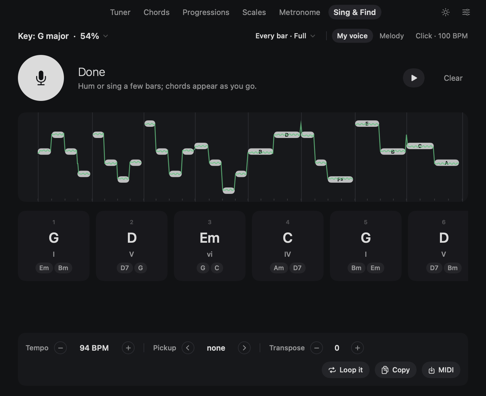
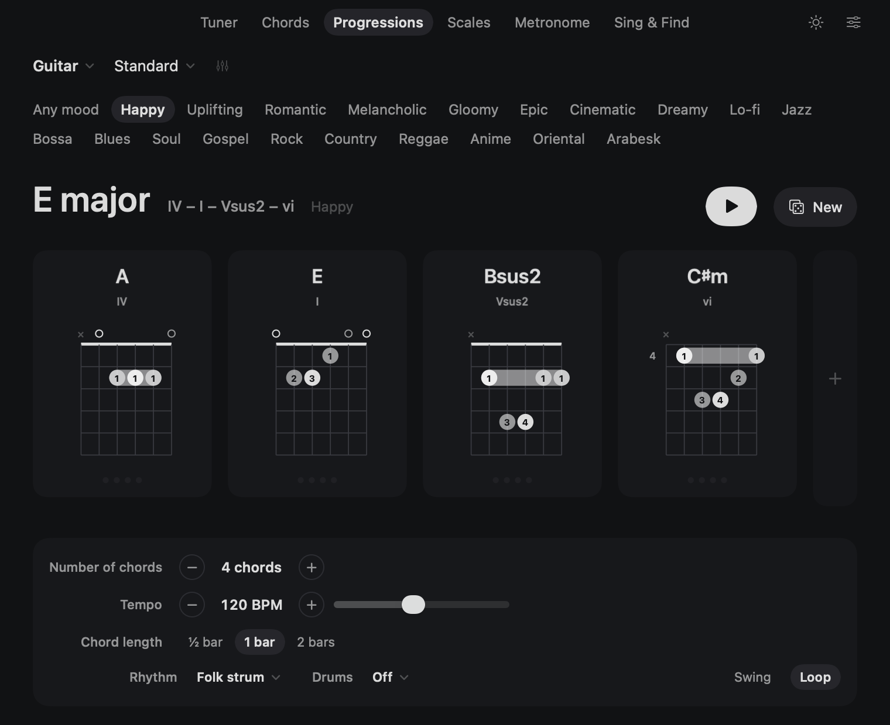
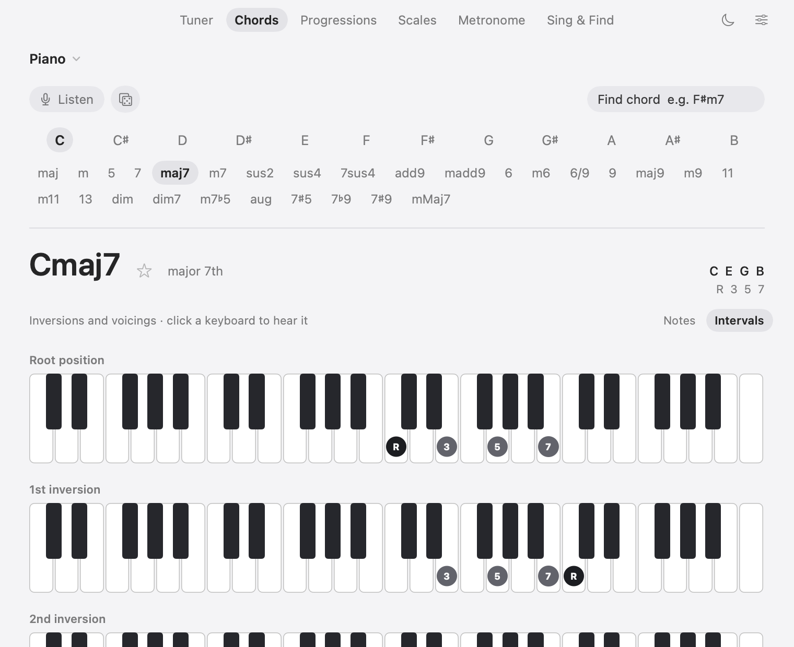

# Chorden

*Every string, in tune.*

A minimal music companion for macOS: a precise tuner, a chord library, a looping progression player,
scales and Turkish makams, a metronome, and Sing & Find, which hears your melody and suggests its chords.
Click the Chorden mark in the menu bar (or press **⌃⌥T** anywhere) to tune in a second.

The name comes from the Greek *chordē*, "string", the root of both *chord* and *cord*. The icon is unison
made visible: two tones at the same pitch, traced against each other as on an oscilloscope, hold still as a
single ellipse, the simplest Lissajous figure. That stillness is what "in tune" looks like. Its stroke turns
from white to green, like a tone settling in tune.

- **Native** Swift + SwiftUI/AppKit. No dependencies, ~23 MB including the instrument recordings.
- **Precise**: McLeod pitch detection (the method used by Tartini) on an FFT, at 50 readings per second. Accurate to ~0.1 cent on a clean signal, from a 5-string bass's low B up through violin.
- **Private**: the microphone runs only while a tuner is on screen. Audio never leaves your Mac.

| Sing & Find | Progressions | Chords on piano |
|---|---|---|
|  |  |  |

## Build

```bash
./build.sh            # build/Chorden.app
./build.sh install    # also copies it to /Applications
```

Requires macOS 13 or later and the Xcode Command Line Tools.

## Tuner

- **Instruments**: piano, guitar (6, 7 and 8 strings), bass (4, 5 and 6 strings), violin, viola, cello, double bass, ukulele, baritone ukulele, mandolin, banjo, tenor banjo, Irish and Greek bouzouki, cavaquinho, balalaika, bağlama, oud, plus a **Chromatic** mode for anything else.
- **Tunings**: 26 for 6-string guitar (standard, E♭/D/C♯/C/B/A standard, Drop D/C♯/C/B/B♭/A, DADGAD, open D/E/G/A/C, and more), plus the common ones for every other instrument. This includes bağlama düzenleri (bozuk, bağlama, misket, müstezat, abdal, kayseri, rast) and Turkish and Arabic oud tunings.
- **Auto string detection** with hysteresis. Click a string (or press **1–8**, **← →**) to lock onto it; **Esc** returns to auto. Strings you've tuned get a green dot. The marks clear when the tuner closes or when you press Esc, and the reference tone never sets them.
- **Three displays**: Needle, Strobe (bands drift at the fundamental, 2nd and 4th harmonic, so tiny deviations stay visible), and Trace (the last 4 seconds of pitch, useful for vibrato and seeing a string settle).
- **Reference tone** (**Space** or the speaker button): a sustained tone at the target pitch for tuning by ear.
- **Settings**: A4 reference (400–480 Hz; quick picks for 432/440/442), in-tune tolerance (±1/2/3/5 ¢), C D E or Do Re Mi note names, ♯ or ♭, input device and channel (for audio interfaces), noise gate, open at login.

## Chords

- 12 roots × 28 chord types, including power chords, sus, add9, 6/9, 9/11/13, diminished, half-diminished, augmented, 7♭9/7♯9, and mMaj7.
- Shapes are **generated for the selected tuning**: Drop D, open G, DADGAD, a 7-string, ukulele, mandolin and banjo each get their own playable grips. Common shapes come first, and the rest are listed up the neck.
- Dots can be labeled with fingers, note names, or intervals. A barre is drawn when one finger covers several strings.
- **Neck** view: every chord tone across the fretboard. For fretless instruments it shows the fingerboard.
- Click a chord box to hear it strummed, or click a dot on the neck to hear that note.
- **⌘F**: type a chord name, for example `F#m7b5`, `Bbmaj7`, `Gsus` or `C°7`.

## Makam

- **Makam tuner** (instrument menu → Makam): pick a makam and a karar, and the tuner targets its degrees exactly, koma pitches included. The deviation is shown in cents and in komas.
- 12 makams in the Arel–Ezgi–Uzdilek system (53 komas per octave): Rast, Uşşak, Hüseyni, Hicaz, Hümayun, Hicazkâr, Kürdî, Nihavend, Bûselik, Mahur, Karcığar and Suzinak. They are spelled the Turkish way: B♭¹ for segâh, F♯⁴ for eviç, and so on.
- On fretless instruments (oud, bağlama, violin) the Scales page draws koma degrees at their exact place. On a guitar they appear at the nearest fret, marked with a dashed outline.

## More

- **All strings**: strum once and see every string's deviation at the same time. Harmonics that two strings share (E2 ×3 = B3) are ignored, so each string is read from its own sound.
- **Intonation**: for each string, play it open, then at the 12th fret. Chorden tells you how far off the octave is and which way to move the saddle.
- **Chord recognition** (Chords → Listen): play a chord and the library follows it, including sus chords and slash chords such as C/G.
- **Progressions** (its own tab): 2 to 12 chords from proven patterns in 20 moods (happy, melancholic, epic, cinematic, dreamy, lo-fi, jazz, bossa, blues, soul, gospel, rock, country, reggae, anime, oriental, arabesk…) in a random key, or your own: click a chord's name to swap it for any chord in the key (or any root and quality), **+** adds a chord that fits, **×** removes one, all while the loop keeps playing. Save a progression with its loop settings (bookmark button) and reopen it from **My progressions**. ▶ loops them with one of 14 rhythms (strums, funk scratch, reggae skank, palm-mute chug, gallop, Travis picking, bossa nova…) and one of 13 drum grooves on a recorded drum kit (soft and hard hits, hi-hat choke) (rock, ballad, four on the floor, funk, blues shuffle, jazz swing, bossa, one drop, boom bap, half-time…), swing, and a chord length of ½, 1 or 2 bars. Events are scheduled on the audio clock, so the loop never drifts. Click a card to hear one chord, or double-click to open it in the library.
- **Scales**: 66 scales (modes, jazz and bebop, pentatonics and blues, Japanese/Chinese/Javanese, Indian ragas, exotic minors, symmetric, Arabic maqamat in quarter tones) plus 17 Turkish makams. You can view the whole neck (or keyboard) or one position box at a time. ▶ plays the scale with its true microtones and lights each note as it sounds.
- **Custom tunings and favorites**: the slider icon next to the tuning menu edits each string and saves the result under My Tunings. Star a tuning to pin it at the top, or star a chord to add it to the favorites row.
- **Metronome**: tap tempo, 2/4 to 7/8, subdivisions, and an accented downbeat. The sounds are real recordings (classic click and bell, wood block, cowbell, hi-hat) plus a clean beep, loudness-matched. Clicks are scheduled inside the audio engine, so they never drift.
- **Türkçe**: Settings → Language. The app starts in Turkish when the Mac's language is Turkish.

## Sing & Find

Press the mic and sing or hum a melody. Chord suggestions appear as you sing.

- **Notes**: your pitch is split into notes. Vibrato and slides stay one note, octave slips are ignored, a scoop belongs to the note it leads into, and the same note sung twice ("la la") is heard as two.
- **Your own tuning**: if you sing a little sharp or flat all the way through, Chorden measures it and names every note against your tuning.
- **Your own tempo**: without a click, a beat tracker follows the singing, so the bars stay with you where you slow down or rush. The tempo is shown, and half or double time is one click away.
- **Key**: Krumhansl–Schmuckler key profiles plus tonal-centre hints, then the key whose chords fit the melody best. Pick another from the Key menu if you like.
- **Chords**: the whole sequence is chosen at once (Viterbi), so each chord fits its bar *and* leads naturally into the next. Every bar or half bar; Simple (I IV V vi), Full, or Rich (7ths, 9ths, 6ths where you sing them). Each chord comes with two alternatives to tap.
- **Pickup**: for songs that start before the first bar, move bar 1 by a beat.
- **Click**: sing with the metronome for a one-bar count-in and bars that follow its tempo.
- **Afterwards**: ▶ plays the chords with your recorded voice (**V** toggles it, also mid-playback) and the melody on your instrument (**M**). Transpose, see a capo suggestion for guitar, loop the chords in Progressions, copy a chord chart, or save a MIDI file whose tempo map follows your singing.

## EarQuiz

Ear training in its own tab (⌘7):

- **Mixed** (the default) draws from every kind in turn, so intervals, chords, scales and notes keep alternating.
- **Intervals** up to the 12th (up, down or together), **Chords** (26 types, from triads to 9ths, 7♭9/7♯9 and 13ths, together or broken), **Scales & Makams** (16 scales and modes plus 17 makams at their true 53-koma pitches) and **Notes**.
- Ready-made sets from beginner to all, or a custom set of answers.
- Space plays and replays, 1–9 answer, Return moves on. A wrong answer shows the right one with its spelled notes, and any answer can be played for comparison.
- Streaks, session accuracy and per-item accuracy are kept; questions you miss come up more often.

## Saving

Progressions and Sing & Find takes (with the recorded voice, chords you picked, tempo and key) are saved in `~/Library/Application Support/Chorden/` and reopen from the **My progressions** and **My takes** menus. Rows can be renamed and deleted.

## Sound

The acoustic guitar is recorded in full: every note from low E to the 24th fret, each played both hard and soft, so nothing is pitch-shifted and gentle strums really sound gentle. Guitars (classical, electric), bass, violin, viola, cello, double bass, banjo and piano play **real recordings**: 163 notes rendered from the MIT-licensed MuseScore General SoundFont (FluidR3 by Frank Wen, FluidR3Mono by Michael Cowgill, MuseScore General by S. Christian Collins; see `Resources/Samples/LICENSE.md`). Each recording's pitch was measured and corrected, so they play in tune to within ~2 cents. Notes between the recorded ones are pitch-shifted with cubic interpolation.

Bağlama (fcerim's CC0 "Baglama Notes" on Freesound) and ukulele (FreePats, CC0) also play real recordings. The oud has no openly licensed single-note recordings, so its physical model was fitted against real oud notes instead. Mandolin, bouzouki, balalaika and cavaquinho use the physical models described below. The metronome and the drum kit are real one-shots from the same MuseScore General kit.

Strings are physically modeled, not sampled. Each string has two vibration planes, which give a fast and a slow decay and a gentle beating. The pick position shapes the tone, and a body adds the resonances of a guitar's air cavity and top plate. Mandolin, bağlama and oud get doubled courses, and everything plays in a small stereo room. A strum moves low to high at a human pace, an upstroke is lighter and mostly hits the treble strings, and a new chord silences the notes it replaces, as a real string would. Each instrument has its own sound (steel, nylon, electric, bass, ukulele, mandolin, banjo, bağlama, oud). For guitars, Settings → Guitar sound picks Acoustic (steel), Classical (nylon) or Electric. Violin, viola, cello and double bass are bowed: a band-limited Helmholtz sawtooth with rosin noise, a gradual bow attack, vibrato that blooms after the note starts, and violin-family body formants.

## Shortcuts

| | |
|---|---|
| ⌃⌥T | Open the menu bar tuner from any app |
| ⌘1 – ⌘7 | Tuner / Chords / Progressions / Scales / Metronome / Sing & Find / EarQuiz |
| ⌘F | Find a chord |
| ⌘R or Space | Reference tone |
| 1–8, ← → | Lock a string |
| Esc | Return to automatic string detection; press again to clear the green tuned marks |
| ⌘K, or Space on the Metronome tab | Start / stop the metronome; ↑ ↓ change the tempo, T taps it |
| Space on the Progressions tab | Play / stop the loop; ↑ ↓ change the tempo |
| Space on the Sing & Find tab | Start / stop listening; V toggles your voice, M the melody |
| ⌘, | Settings |
